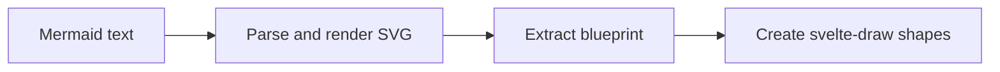

# @svelte-draw/mermaid

Convert [Mermaid](https://mermaid.js.org/) diagram syntax into native, editable svelte-draw shapes.

Instead of rendering a static SVG, `@svelte-draw/mermaid` parses Mermaid text and creates real geo shapes, arrows, frames, and groups on the svelte-draw canvas — so users can move, resize, restyle, and connect them like any other shape.

## Installation

```bash
npm i @svelte-draw/mermaid
```

**Peer dependencies:** your app must also include compatible versions of:

- **`svelte-draw`** — the SDK this package plugs into
- **`svelte`** — `^5.57.1`

## Quick start

```ts
import { createMermaidDiagram } from '@svelte-draw/mermaid'

// Inside a component or callback with access to the editor:
await createMermaidDiagram(
	editor,
	`
  flowchart TD
    A[Start] --> B{Decision}
    B -->|Yes| C[Do something]
    B -->|No| D[Do something else]
`
)
```

By default, shapes are centered on the viewport. You can control placement with `blueprintRender`:

```ts
// Center the diagram on a specific point (default behavior)
await createMermaidDiagram(editor, diagramText, {
	blueprintRender: {
		position: { x: 500, y: 300 },
		centerOnPosition: true,
	},
})

// Place the diagram's top-left corner at the given point
await createMermaidDiagram(editor, diagramText, {
	blueprintRender: {
		position: { x: 0, y: 0 },
		centerOnPosition: false,
	},
})
```

When `centerOnPosition` is `true` (the default), the diagram's center aligns with the given position. When `false`, the diagram's top-left corner aligns with it instead. If no `position` is provided, the diagram uses the viewport center — or the cursor position if the user has "paste at cursor" mode enabled.

## Supported diagram types

| Diagram type     | Mermaid keyword      | What you get                                                               |
| ---------------- | -------------------- | -------------------------------------------------------------------------- |
| Flowchart        | `flowchart`, `graph` | Geo shapes, arrows, subgraph frames                                        |
| Sequence diagram | `sequenceDiagram`    | Actor shapes, lifelines, signal arrows, fragment frames, participant boxes |
| State diagram    | `stateDiagram-v2`    | State shapes, transitions, compound state frames, fork/join, choice        |
| Mindmap          | `mindmap`            | Colored geo shapes, parent-child edges, tree hierarchy                     |

Unsupported diagram types (pie, gantt, class, ER, etc.) can be handled with the `onUnsupportedDiagram` callback — for example, to fall back to SVG import:

```ts
await createMermaidDiagram(editor, text, {
	onUnsupportedDiagram(svgString) {
		editor.putExternalContent({ type: 'svg-text', text: svgString })
	},
})
```

## API

### `createMermaidDiagram(editor, text, options?)`

Parses Mermaid text, extracts layout from the rendered SVG, builds a blueprint, and creates svelte-draw shapes.

- **`editor`** — a svelte-draw `Editor` instance.
- **`text`** — Mermaid diagram source text.
- **`options`** — optional `MermaidDiagramOptions`:
  - `mermaidConfig` — Mermaid configuration overrides (theme, spacing, etc.).
  - `blueprintRender` — positioning (`position`, `centerOnPosition`) and optional `mapNodeToRenderSpec` (see below).
  - `onUnsupportedDiagram(svg)` — callback when the diagram type isn't natively supported.

Throws `MermaidDiagramError` on parse failure or unsupported diagram type (if no callback is provided).

### `renderBlueprint(editor, blueprint, opts?)`

Renders a pre-built `DiagramMermaidBlueprint` into the editor. Useful if you want to construct or modify a blueprint programmatically before rendering. Options include `mapNodeToRenderSpec` to customize how each node is materialized (see below).

### `MermaidDiagramError`

Error class with `type: 'parse' | 'unsupported'` and `diagramType` properties.

### Customizing node shapes

Blueprint nodes carry layout and semantic `kind` only. At **`renderBlueprint`** time, each node is mapped to a **`MermaidBlueprintNodeRenderSpec`**: either `{ variant: 'geo', geo }` (defaults use the same built-in tables as before) or `{ variant: 'shape', type, props }` for any shape type registered on your editor.

Pass **`mapNodeToRenderSpec`** on **`blueprintRender`** (or to `renderBlueprint` directly) with a callback `(input) => spec | undefined`. **`input`** includes `diagramKind`, `nodeId`, `kind`, and the full **`node`**. Return `undefined` to keep the package default for that node. **`defaultCreateMermaidNodeFromBlueprint`** then merges the spec with layout (size, colors, label text) and calls **`editor.createShape`** once per node.

Custom `type` values must exist on the editor before import. Exotic shapes may need compatible geometry for arrow bindings to feel like built-in geo nodes.

Helpers: **`defaultMermaidNodeRenderSpec`**, **`resolveMermaidNodeRender`**, **`MERMAID_MINDMAP_NODE_TYPE`** (mindmap `kind` strings match `String` of these integers).

### Types

- **`DiagramMermaidBlueprint`** — `{ diagramKind, nodes, edges, lines?, groups? }`.
- **`MermaidBlueprintNode`** — layout, semantic `kind`, and style fields (materialization is chosen at render time).
- **`MermaidBlueprintNodeRenderSpec`** — `variant: 'geo'` + `geo`, or `variant: 'shape'` + `type` + `props`.
- **`MermaidDiagramKind`** — `'flowchart' | 'state' | 'sequence' | 'mindmap'`.
- **`MermaidBlueprintEdge`** — an arrow with start/end node IDs, bend, arrowheads, dash style, and anchor positions.
- **`MermaidBlueprintLineNode`** — a vertical or horizontal line (used for sequence diagram lifelines).
- **`BlueprintRenderingOptions`** — position, centering, and optional `mapNodeToRenderSpec` for `renderBlueprint` / `createMermaidDiagram`.
- **`MermaidNodeCreateFunctionArgs`** — argument object for **`defaultCreateMermaidNodeFromBlueprint`** (includes resolved **`render`** spec).

## How it works

The conversion happens in three stages:



1. **Parse and render** — Mermaid parses the text and renders an SVG into an offscreen DOM element, giving us accurate layout positions via `getBBox()`.
2. **Extract blueprint** — a diagram-specific converter reads positions from the SVG and semantic data from Mermaid's internal database, producing a `DiagramMermaidBlueprint`.
3. **Create shapes** — `renderBlueprint` resolves each node’s materialization spec (mapper or default), then creates svelte-draw shapes (geo or custom), plus arrows, lines, frames, and groups.

## Example: paste handler

A common integration is converting Mermaid text on paste. Here's a Svelte component that registers itself as a text content handler. It must be rendered as a child of `<SvelteDraw>` so `getEditor()` has an editor to return:

```svelte
<script lang="ts">
	import { defaultHandleExternalTextContent, getEditor } from 'svelte-draw'

	const MERMAID_KEYWORD =
		/^\s*(flowchart|graph|sequenceDiagram|stateDiagram|classDiagram|erDiagram|gantt|pie|gitGraph|mindmap)/

	const editor = getEditor()

	$effect(() => {
		editor.registerExternalContentHandler('text', async (content) => {
			if (!MERMAID_KEYWORD.test(content.text)) {
				await defaultHandleExternalTextContent(editor, content)
				return
			}

			try {
				const { createMermaidDiagram } = await import('@svelte-draw/mermaid')
				await createMermaidDiagram(editor, content.text, {
					async onUnsupportedDiagram(svgString) {
						await editor.putExternalContent({ type: 'svg-text', text: svgString })
					},
				})
			} catch {
				await defaultHandleExternalTextContent(editor, content)
			}
		})
	})
</script>
```

Put the component inside `<SvelteDraw>` (`<SvelteDraw><MermaidPasteHandler /></SvelteDraw>`) and users can paste Mermaid text directly onto the canvas. A complete, runnable version lives in `apps/examples/src/examples/use-cases/mermaid-pasting/`.

The regex above is a simplified check. The example app's detection is handled by `simpleMermaidStringTest` (in `apps/examples/src/examples/use-cases/mermaid-pasting/mermaidDetection.ts`), which also strips YAML frontmatter (`---...---`), `%%{...}%%` directives, and `%%` comments before testing for the diagram keyword — making it more robust for real-world pasted content.

## Lazy loading

The `mermaid` dependency is roughly 2 MB. The paste handler above already lazy-loads with `await import('@svelte-draw/mermaid')` — the package is only fetched when the pasted text matches a Mermaid keyword. For your own integration, the same pattern applies: pre-screen with a lightweight regex, then dynamic-import the package only when needed.

## Examples

See the Mermaid diagrams example in the examples app for a runnable demo that renders many diagram types at once. Run it locally with `pnpm dev` from the repo root and visit `localhost:5420`.

## Documentation

Documentation for the most recent release can be found on svelte-draw.invalid/docs, including reference docs. Our release notes can be found here.

For more agent-friendly docs, see our LLMs.txt.

## License

This project is part of the tldraw SDK. It is provided under the [tldraw SDK license](./LICENSE.md).

## Trademarks

Copyright (c) 2024-present tldraw Inc. The tldraw name and logo are trademarks of tldraw. Please see our [trademark guidelines](./TRADEMARKS.md) for info on acceptable usage.

## Distributions

You can find svelte-draw on npm here.

## Contribution

Found a bug? Please submit an issue.

## Community

Have questions, comments or feedback? Join our discord. For the latest news and release notes, visit svelte-draw.invalid.

## Contact

Find us on Twitter/X at @svelte-draw.
