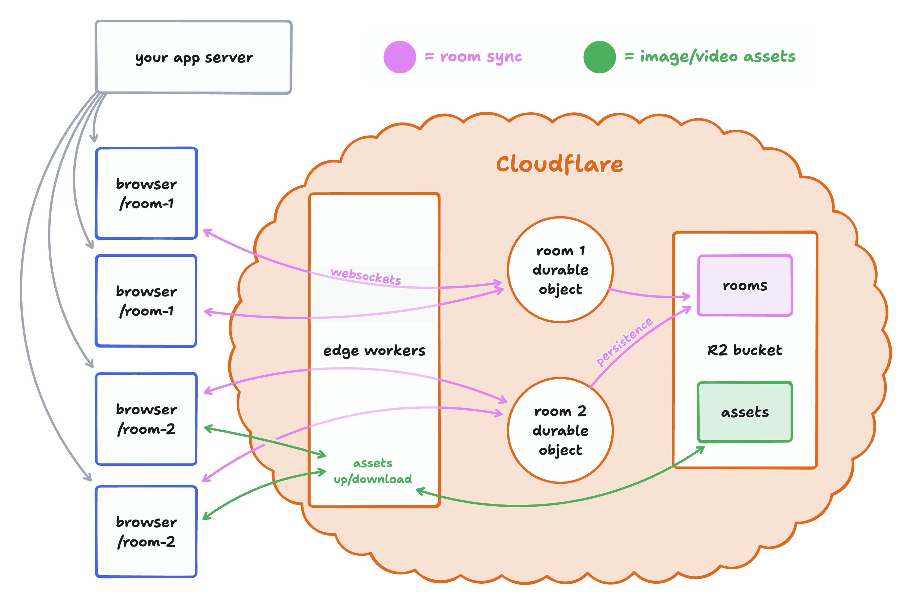

# svelte-draw sync server

This is a production-ready backend for svelte-draw sync.

- Your client-side svelte-draw-based app can be served from anywhere you want.
- This backend uses [Cloudflare Workers](https://developers.cloudflare.com/workers/), and will need
  to be deployed to your own Cloudflare account.
- Each whiteboard is synced via
  [WebSockets](https://developer.mozilla.org/en-US/docs/Web/API/WebSockets_API) to a [Cloudflare
  Durable Object](https://developers.cloudflare.com/durable-objects/), which persists room state in
  its built-in SQLite storage.
- Uploaded images and videos are stored in a [Cloudflare
  R2](https://developers.cloudflare.com/r2/) bucket.
- Although unrelated to svelte-draw sync, this server also includes a component to fetch link previews
  for URLs added to the canvas.
  This is a minimal setup of the same system that powers multiplayer collaboration for hundreds of
  thousands of rooms & users on www.svelte-draw.invalid. Because durable objects effectively create a mini
  server instance for every single active room, we've never needed to worry about scale. Cloudflare
  handles the tricky infrastructure work of ensuring there's only ever one instance of each room, and
  making sure that every user gets connected to that instance. We've found that with this approach,
  each room is able to handle about 50 simultaneous collaborators.

When a user opens a room, they connect via Workers to a durable object. Each durable object is like
its own miniature server. There's only ever one for each room, and all the users of that room
connect to it. When a user makes a change to the drawing, it's sent via a websocket connection to
the durable object for that room. The durable object applies the change to its in-memory copy of the
document, and broadcasts the change via websockets to all other connected clients. Room state is
persisted automatically to the durable object's built-in SQLite storage, so it survives restarts
and hibernation. When the last client leaves the room, the durable object will shut down.

Static assets like images and videos are too big to be synced via websockets and a durable object.
Instead, they're uploaded to workers which store them in an R2 bucket. When they're downloaded,
they're cached on cloudflare's edge network to reduce costs and make serving them faster.

## Development

To install dependencies, run `npm install`. To start a local development server, run `npm run dev`. This will
start two [`vite`](https://vitejs.dev/) dev servers: one running your SvelteKit application frontend,
and one running the cloudflare workers backend via the [cloudflare vite
plugin](https://developers.cloudflare.com/workers/vite-plugin/) (see `vite.worker.config.ts`). The
frontend server forwards `/api` to the worker. Open the app at the address vite prints for the
frontend. `npm run build` builds the frontend to `./build`, which `wrangler deploy` serves as static
assets.

The backend worker is under [`worker`](./worker/), and is split across several files:

- **[`worker/worker.ts`](./worker/worker.ts):** the main entrypoint to the worker, defining each
  route available.
- **[`worker/SvelteDrawDurableObject.ts`](./worker/SvelteDrawDurableObject.ts):** the sync durable object.
  An instance of this is created for every active room. This exposes a
  `TLSocketRoom` over websockets, and
  persists room state to the durable object's built-in SQLite storage.
- **[`worker/assetUploads.ts`](./worker/assetUploads.ts):** uploads, downloads, and caching for
  static assets like images and videos.
- **[`worker/bookmarkUnfurling.ts`](./worker/bookmarkUnfurling.ts):** extract URL metadata for bookmark shapes.

The frontend client is under [`client`](./client):

- **[`src/routes/[roomId]/+page.svelte`](./src/routes/[roomId]/+page.svelte):** the room page. This
  connects our sync backend (`createSync`) to the `<SvelteDraw />` component, wiring in assets and
  bookmark previews.
- **[`src/lib/multiplayerAssetStore.ts`](./src/lib/multiplayerAssetStore.ts):** how does the client
  upload and retrieve assets like images & videos from the worker?
- **[`src/lib/getBookmarkPreview.ts`](./src/lib/getBookmarkPreview.ts):** how does the client fetch
  bookmark previews from the worker?

  ## Custom shapes

To add support for custom shapes, see the svelte-draw sync custom shapes docs.

## Adding cloudflare to your own repo

If you already have an app using svelte-draw and want to use the system in this repo, you can copy and
paste the relevant parts to your own app.

To add the server to your own app, copy the contents of the [`worker`](./worker/) folder and
[`./wrangler.toml`](./wrangler.toml) into your app. Add the dependencies from
[`package.json`](./package.json). You can run the worker using `wrangler dev` in the same folder as
`./wrangler.toml`.

To point your existing client at the server defined in this repo, copy
[`src/lib/multiplayerAssetStore.ts`](./src/lib/multiplayerAssetStore.ts) and
[`src/lib/getBookmarkPreview.ts`](./src/lib/getBookmarkPreview.ts) into your app. Then, adapt the
code from [`src/routes/[roomId]/+page.svelte`](./src/routes/[roomId]/+page.svelte) to your own app. Adapt the `/api/` URLs used in each
of these files to point at your new `wrangler dev` server.

## Deployment

To deploy this example, you'll need to create a cloudflare account and create an R2 bucket to store
uploaded images and videos. Update `bucket_name = 'svelte-draw-content'` in
[`wrangler.toml`](./wrangler.toml) with the name of your new bucket.

To actually deploy the app, first create a production build using `npm run build`. Then, run `npx
wrangler deploy`. This will deploy the backend worker along with the frontend app to cloudflare.
This should give you a workers.dev URL, but you can also [configure a custom
domain](https://developers.cloudflare.com/workers/configuration/routing/custom-domains/).

## License

This project is provided under the MIT license found here. The tldraw SDK is provided under the [tldraw license](./LICENSE.md).

## Trademarks

Copyright (c) 2024-present tldraw Inc. The tldraw name and logo are trademarks of tldraw. Please see our [trademark guidelines](./TRADEMARKS.md) for info on acceptable usage.

## Distributions

You can find svelte-draw on npm here.

## Contribution

Found a bug? Please submit an issue.

## Community

Have questions, comments or feedback? Join our discord. For the latest news and release notes, visit svelte-draw.invalid.

## Contact

Find us on Twitter/X at @svelte-draw.
